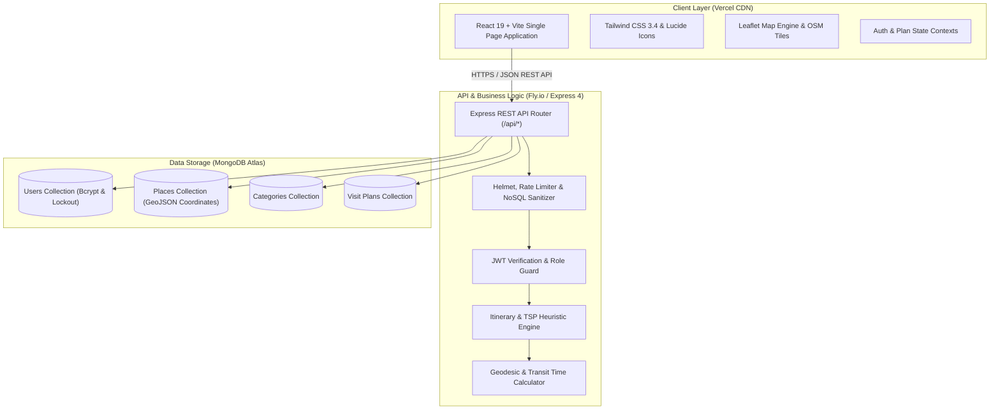

# 🌴 Walasmulla Local Tourist Day-Visit Planner

<div align="center">

[](https://walasmulla-tourist-planner-client.vercel.app)
[](https://walasmulla-tourist-planner.fly.dev)
[](https://react.dev/)
[](https://nodejs.org/)
[](https://www.mongodb.com/)
[](https://tailwindcss.com/)

<p align="center">
  <strong>An Intelligent MERN-Stack Tourism Itinerary & Day-Visit Planner for Walasmulla and Surrounding Attractions</strong>
</p>
<p align="center">
  <em>Bachelor of Information Technology (BIT) — Module ITE2953: Programming Group Project</em>
</p>

[🌐 Explore Live Application](https://walasmulla-tourist-planner-client.vercel.app) • [📖 Documentation](#-documentation--srs-alignment) • [✨ Key Features](#-key-features) • [🚀 Quick Start](#-local-development-setup) • [👥 Team](#-project-team--contributors)

---

</div>

## 📌 Executive Summary

The **Walasmulla Local Tourist Day-Visit Planner** is a specialized, production-ready web application engineered to promote sustainable rural and eco-cultural tourism in the Southern Province of Sri Lanka. Focused on a curated **25-kilometer radius** centered around Walasmulla town (`6.155° N, 80.700° E`), the platform bridges the gap between travelers and authentic regional attractions.

Built using the **MERN stack (MongoDB, Express.js, React 19, Node.js)**, the application provides an automated itinerary engine with a Traveling Salesperson Problem (TSP) greedy heuristic, real-time travel estimations, dynamic cultural dress-code advisory, interactive OpenStreetMap routing, and robust role-based access control (RBAC).

---

## 🎯 Project Objectives & Problem Statement

### 🔍 Problem Context
Walasmulla is rich in heritage sites, wildlife sanctuaries, agricultural reserves, and scenic nature spots. However, international and domestic tourists frequently encounter:
1. **Fragmented Information:** Lack of verified local details, opening hours, dress codes, and entry tariffs.
2. **Suboptimal Routing:** Inefficient travel sequencing leading to wasted time on rural provincial roads.
3. **Safety & Cultural Gaps:** Missed daylight deadlines, late-evening travel risks, and violations of religious site dress codes.

### 💡 Proposed Solution
- **Curated Attraction Directory:** Comprehensive place cards with rich imagery, categories, entrance fees, and religious dress-code alerts.
- **Intelligent Day Planner:** Automatic nearest-neighbour greedy route sorting or custom manual sequencing.
- **Travel Time & Sunset Advisory:** Haversine distance calculations adapted with Sri Lankan provincial road speed factors and automatic alerts when itineraries exceed safe daylight hours (18:00).
- **Personalized Itineraries:** Registered tourists can save, manage, and retrieve customized plans.
- **Administrative Portal:** Secure dashboard for verified administrators to manage places, categories, and tourist accounts.

---

## 🌐 Live Deployment & Demo Credentials

| Resource | Environment | Link / URL |
| :--- | :--- | :--- |
| **Frontend Web App** | Production (Vercel) | [https://walasmulla-tourist-planner-client.vercel.app](https://walasmulla-tourist-planner-client.vercel.app) |
| **Backend API** | Production (Fly.io) | `https://walasmulla-tourist-planner.fly.dev` |
| **Database** | Cloud Cluster | MongoDB Atlas |

### 🔑 Evaluation & Demo Credentials

For academic evaluators, examiners, and testers, pre-configured accounts are provided:

```
┌────────────────────────────────────────────────────────────────────────┐
│ 👤 TOURIST ACCOUNT (Plan creation, saving & itinerary management)      │
│    • Username: tourist1                                                │
│    • Password: Tourist@123                                             │
├────────────────────────────────────────────────────────────────────────┤
│ 🛡️ ADMIN ACCOUNT (Full CRUD on Places, Categories, and User Accounts)   │
│    • Username: admin                                                   │
│    • Password: Admin@secure123!                                        │
└────────────────────────────────────────────────────────────────────────┘
```
> *Self-registration is also available for guests on the Live Demo site.*

---

## ✨ Key Features

### 1. 📍 Interactive Places & Category Directory
- Filter places across **Historical / Heritage**, **Nature & Wildlife**, **Adventure & Scenic**, **Religious**, and **Local Culture**.
- Search by keywords with instant debounced query matching.
- Visual badges for estimated visit duration, distance from Walasmulla centre, and entry fees.
- **Cultural Etiquette Callout:** Distinct alerts for temples (e.g., Mandaduwa Viharaya) reminding visitors of respectful attire.

### 2. 🧭 Smart Day Itinerary Engine
- **Auto Optimization (Greedy Nearest-Neighbour):** Calculates the most efficient path starting from Walasmulla town centre.
- **Manual Ordering:** Up/Down directional reordering controls ensuring accessible and straightforward stop adjustments.
- **Dynamic Time Calculation:** Real-time arrival time, visit duration, and transit time computations.
- **Safety Warning System:**
  - ⚠️ Triggers warnings if the planned itinerary finishes after **18:00 (sunset)**.
  - 🌙 Identifies night-time specific activities (e.g., Rekawa Turtle Conservation) and alerts users when scheduled during daytime hours.

### 3. 🗺️ Interactive Maps & 3D Radar Visualizer
- **Leaflet & OpenStreetMap Integration:** Custom interactive map markers with category icons and route polylines.
- **Tour Radar & 3D Interactive Modal:** Visual perspective showcasing spatial distribution of attractions relative to Walasmulla center.

### 4. 🔒 Enterprise-Grade Security & Authentication
- **Stateful JWT Authentication:** Role-based access control (`tourist` and `admin`).
- **Cryptographic Security:** Passwords salted and hashed with **bcrypt (cost factor 12)**.
- **Brute-Force Protection:** Automatically locks user accounts for **15 minutes after 5 consecutive failed login attempts**.
- **Defense in Depth:** Helmet HTTP security headers, CORS origin whitelisting, Express rate limiting, and NoSQL injection sanitization.

### 5. ⚙️ Administrative Dashboard
- Complete management interface for Places, Categories, and User statuses (`active` / `blocked`).
- Auto-estimation of geodesic distance using coordinates with admin manual override capability.

---

## 🏗️ System Architecture



---

## 🛠️ Technology Stack

| Layer | Technology | Version | Purpose |
| :--- | :--- | :--- | :--- |
| **Frontend Framework** | **React** | `19.2.x` | Component-based reactive UI |
| **Build Tool** | **Vite** | `6.x` | Lightning-fast development & production bundling |
| **Styling** | **Tailwind CSS** | `3.4.x` | Utility-first responsive design system |
| **Maps & GIS** | **Leaflet & React-Leaflet** | `1.9.4 / 5.0` | Geospatial mapping & routing visualization |
| **Icons & Visuals** | **Lucide React** | `0.400+` | Clean, modern vector icons |
| **Backend Runtime** | **Node.js** | `>= 20.0.0` | High-throughput asynchronous runtime |
| **API Framework** | **Express.js** | `4.19.x` | RESTful routing and middleware pipeline |
| **Database** | **MongoDB Atlas** | `7.0+` | Cloud document database |
| **ODM** | **Mongoose** | `8.4.x` | Object data modeling and schema validation |
| **Security & Auth** | **JWT & BcryptJS** | `9.0 / 2.4` | Stateless bearer token auth & credential hashing |
| **Security Suite** | **Helmet, Rate-Limit, Sanitize** | Latest | Header hardening, brute-force & injection defense |
| **Testing** | **Jest, Supertest, Vitest** | Latest | Unit, integration, and UI component testing |
| **Deployment** | **Vercel & Fly.io** | Cloud | Automated CI/CD, SSL/TLS, and edge caching |

---

## 📐 Algorithmic Details

### 1. Traveling Salesperson (TSP) Greedy Nearest-Neighbour
When **Auto Mode** is chosen, the engine generates an optimal sequence minimizing cumulative travel:
1. Origin point: Walasmulla Town Centre (`6.155, 80.700`).
2. Current location searches the unvisited set for the point with the lowest travel time.
3. Next stop is appended to the itinerary; current position updates to that stop.
4. Process repeats until all selected destinations are visited.

### 2. Regional Geodesic Distance & Travel Time Formulation
Distance between two geographic coordinates $(\phi_1, \lambda_1)$ and $(\phi_2, \lambda_2)$ is derived using the Great-Circle Haversine Formula:

$$d = 2R \cdot \arcsin\left(\sqrt{\sin^2\left(\frac{\Delta\phi}{2}\right) + \cos(\phi_1)\cos(\phi_2)\sin^2\left(\frac{\Delta\lambda}{2}\right)}\right)$$

- Radius of Earth $R \approx 6,371\text{ km}$
- Road Winding Factor: Regional roads in Walasmulla are adjusted with a coefficient of **$1.3\times$ straight-line distance**.
- Transit speed is calculated using calibrated average rural road speeds (approx. **30 km/h**).

---

## 📡 RESTful API Reference

### 🔓 Public Endpoints
```http
GET  /api/categories                    # List all active categories
GET  /api/places?category=&q=          # Search & filter places
GET  /api/places/:slugOrId              # Retrieve detailed place data
POST /api/plans/generate                # Generate itinerary (open to guests)
```

### 🔐 Authentication Endpoints
```http
POST /api/auth/register                 # Register a tourist account
POST /api/auth/login                    # Login & receive JWT (account lockout enabled)
GET  /api/auth/me                       # Verify active session
```

### 🎒 Tourist Plan Endpoints *(Bearer JWT Required)*
```http
GET    /api/plans                       # Retrieve all saved itineraries for user
POST   /api/plans                       # Save a new customized day plan
GET    /api/plans/:id                   # View single saved plan
PUT    /api/plans/:id                   # Update an existing plan
DELETE /api/plans/:id                   # Delete a plan
```

### 🛡️ Admin Endpoints *(Bearer JWT, Role: Admin)*
```http
GET    /api/admin/places                # List all places (including inactive)
POST   /api/admin/places                # Create new tourist destination
PUT    /api/admin/places/:id            # Update destination details
DELETE /api/admin/places/:id            # Remove destination
POST   /api/admin/categories            # Create new category
PUT    /api/admin/categories/:id        # Update category
DELETE /api/admin/categories/:id        # Delete category
GET    /api/admin/users                 # List registered tourist accounts
PATCH  /api/admin/users/:id/status      # Suspend or activate user ("active" | "blocked")
DELETE /api/admin/users/:id             # Delete account
```

---

## 🚀 Local Development Setup

### 📋 Prerequisites
- **Node.js**: `v20.0.0` or higher
- **npm**: `v9.0.0` or higher
- **MongoDB**: Local MongoDB instance or free MongoDB Atlas URI

### 1. Clone & Install Dependencies
```bash
# Clone the repository
git clone https://github.com/heshan123vitharana/walasmulla-tourist-planner.git
cd walasmulla-tourist-planner

# Install server dependencies
cd server
npm install

# Install client dependencies
cd ../client
npm install
```

### 2. Environment Configuration

#### Server (`server/.env`)
```ini
MONGODB_URI=mongodb+srv://<user>:<password>@cluster.mongodb.net/walasmulla_tourist
JWT_SECRET=your_super_secret_jwt_key_at_least_32_chars_long
PORT=5000
NODE_ENV=development
CORS_ORIGINS=http://localhost:5173,http://localhost:5174
ADMIN_USERNAME=admin
ADMIN_PASSWORD=Admin@secure123!
```

#### Client (`client/.env`)
```ini
# Leave empty in local dev to let Vite reverse-proxy handle /api requests
VITE_API_BASE_URL=
VITE_DEBUG_API=false
```

### 3. Seed Database
Run the idempotent seed script to populate categories, initial verified places, admin account, and sample tourist users:
```bash
cd server
npm run seed
```

### 4. Run Development Servers
Open two terminal windows:

```bash
# Terminal 1 — Start Express API server (port 5000)
cd server
npm run dev

# Terminal 2 — Start Vite frontend dev server (port 5173)
cd client
npm run dev
```

Visit **`http://localhost:5173`** in your browser.

---

## 🧪 Testing & Quality Assurance

The codebase features comprehensive unit, integration, and UI test coverage:

```bash
# Run Server API Tests (Jest + Supertest + In-Memory MongoDB)
cd server
npm test

# Run Client Unit/Component Tests (Vitest + React Testing Library)
cd client
npm test

# Linting and Code Style
cd server && npm run lint
cd ../client && npm run lint
```

---

## 📁 Repository Structure

```
walasmulla-tourist-planner/
├── .vscode/                 # Editor configurations
├── docs/                    # Academic SRS and system specifications
│   ├── ASSUMPTIONS.md       # Documented development assumptions
│   ├── DATA_TO_VERIFY.md    # Verified local geospatial & tariff data
│   ├── SRS.pdf              # Software Requirements Specification
│   └── SRS_CHANGES.md       # Change log & architectural decisions
├── client/                  # Frontend Single Page Application (React 19 + Vite)
│   ├── src/
│   │   ├── api/             # Axios API service clients
│   │   ├── components/      # Reusable UI widgets, Leaflet Map, 3D Radar
│   │   ├── context/         # AuthContext & PlanContext state providers
│   │   ├── pages/           # Views (Home, Directory, Planner, Detail, Admin)
│   │   │   └── admin/       # Protected Admin dashboard views
│   │   ├── utils/           # Time calculation & formatting helpers
│   │   ├── App.jsx          # Route declarations & route guards
│   │   └── main.jsx         # App bootstrap entry point
│   ├── tailwind.config.js   # Tailwind custom design tokens
│   └── vite.config.js       # Vite build & local proxy configuration
├── server/                  # Backend REST API (Node.js & Express)
│   ├── scripts/
│   │   └── seed.js          # Database seeding script
│   ├── src/
│   │   ├── config/          # Constants, database connection & environment
│   │   ├── controllers/     # Request handlers (Auth, Place, Plan, Admin)
│   │   ├── middleware/      # JWT auth, RBAC, error handler, sanitizers
│   │   ├── models/          # Mongoose Data Models (User, Place, Category, Plan)
│   │   ├── routes/          # Express route declarations
│   │   ├── services/        # Core business logic & TSP optimization engine
│   │   ├── utils/           # Haversine distance & math utilities
│   │   └── app.js           # Express application initialization
│   ├── tests/               # Backend test suites (Jest & Supertest)
│   ├── Dockerfile           # Production container configuration
│   └── fly.toml             # Fly.io deployment manifest
└── README.md                # Project documentation
```

---

## 📖 Documentation & SRS Alignment

This project is fully designed and documented according to standard Software Engineering principles:
- **Software Requirements Specification (SRS):** Available under [`docs/SRS.pdf`](docs/SRS.pdf).
- **Assumptions Log:** Available under [`docs/ASSUMPTIONS.md`](docs/ASSUMPTIONS.md).
- **Data Verification Log:** Available under [`docs/DATA_TO_VERIFY.md`](docs/DATA_TO_VERIFY.md).
- **SRS Revisions & Traceability:** Detailed in [`docs/SRS_CHANGES.md`](docs/SRS_CHANGES.md).

---

## 👥 Project Team & Contributors

*Submitted in partial fulfillment of the requirements for module **ITE2953: Programming Group Project** — Bachelor of Information Technology (BIT).*

| Contributor Name | Student ID | Primary Responsibilities |
| :--- | :--- | :--- |
| **Heshan Vitharana** | *(Lead Developer)* | Full-Stack Architecture, TSP Itinerary Engine, Deployment & UI Design |
| **Group Member 2** | *BIT Student ID* | Frontend Directory, Responsive UI & Leaflet Map Integration |
| **Group Member 3** | *BIT Student ID* | Backend REST API, Mongoose Models & Security Middleware |
| **Group Member 4** | *BIT Student ID* | Testing, Data Verification, Quality Assurance & Documentation |

---

## 📜 License

This project is developed for educational purposes as an academic group project under the MIT License.
