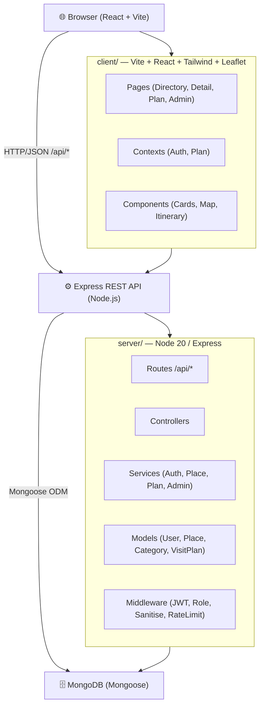

# 🌴 Walasmulla Local Tourist Day-Visit Planner

> A responsive MERN-stack web app for tourists exploring places of interest within 25 km
> of Walasmulla, Southern Province, Sri Lanka.

[](https://nodejs.org)
[](https://reactjs.org)
[](https://mongodb.com)
[](#)

---

## 📋 Table of Contents

1. [Features](#features)
2. [Architecture](#architecture)
3. [Prerequisites](#prerequisites)
4. [Quick Start](#quick-start)
5. [Environment Variables](#environment-variables)
6. [npm Scripts](#npm-scripts)
7. [API Reference](#api-reference)
8. [Milestones & Status](#milestones--status)
9. [Testing](#testing)
10. [Security Notes](#security-notes)
11. [Deployment (HTTPS)](#deployment-https)
12. [Known Data Placeholders](#known-data-placeholders)
13. [Contributing](#contributing)

---

## Features

- **Directory** — Browse/search/filter 10 places of interest near Walasmulla
- **Place Detail** — Full info, Leaflet map, dress-code callout for religious/heritage sites
- **Day Planner** — Build a one-day itinerary with auto or manual ordering; see ETA, finish
  time and travel time per stop; visual route map
- **Save Plans** — Registered tourists can save, reload and delete plans
- **Admin Dashboard** — Manage places, categories and tourist accounts
- **Mobile-first** — Responsive at 375 px through desktop; accessible (WCAG AA target)

---

## Architecture



---

## Prerequisites

| Tool | Version |
|------|---------|
| Node.js | ≥ 20.0.0 |
| npm | ≥ 9.0.0 |
| MongoDB | ≥ 6.0 (or MongoDB Atlas) |

---

## Quick Start

```bash
# 1. Clone the repository
git clone https://github.com/heshan123vitharana/walasmulla-tourist-planner.git
cd walasmulla-tourist-planner

# 2. Set up server environment
cp server/.env.example server/.env
# Edit server/.env — set MONGODB_URI and JWT_SECRET

# 3. Set up client environment (optional — Vite proxy covers local dev)
cp client/.env.example client/.env

# 4. Install dependencies
cd server && npm install
cd ../client && npm install

# 5. Seed the database (creates admin, categories, 10 places)
cd ../server && npm run seed

# 6. Start development servers (two terminals)
# Terminal 1:
cd server && npm run dev
# Terminal 2:
cd client && npm run dev

# Open http://localhost:5173
```

---

## Environment Variables

### Server (`server/.env`)

| Variable | Required | Default | Description |
|----------|----------|---------|-------------|
| `MONGODB_URI` | ✅ | — | MongoDB connection string |
| `JWT_SECRET` | ✅ | — | Min 32-char random string |
| `PORT` | ❌ | `5000` | HTTP port |
| `NODE_ENV` | ❌ | `development` | `development` / `production` / `test` |
| `CORS_ORIGINS` | ❌ | `http://localhost:5173` | Comma-separated allowed origins |
| `ADMIN_USERNAME` | ✅ | — | Admin account username (seed only) |
| `ADMIN_PASSWORD` | ✅ | — | Admin account password (seed only; strong in production) |

### Client (`client/.env`)

| Variable | Required | Default | Description |
|----------|----------|---------|-------------|
| `VITE_API_BASE_URL` | ❌ | *(Vite proxy)* | Set in production to point to your API |
| `VITE_DEBUG_API` | ❌ | `false` | Log API calls in browser console |

---

## npm Scripts

### Server (`cd server`)

| Script | Description |
|--------|-------------|
| `npm run dev` | Start with nodemon (hot reload) |
| `npm start` | Start in production mode |
| `npm test` | Run Jest test suite |
| `npm run seed` | Seed DB (idempotent) |
| `npm run lint` | ESLint check |

### Client (`cd client`)

| Script | Description |
|--------|-------------|
| `npm run dev` | Vite dev server (port 5173) |
| `npm run build` | Production build |
| `npm test` | Vitest test suite |
| `npm run lint` | ESLint check |

---

## API Reference

> Full collection available in `docs/postman_collection.json`.

### Public

```
GET  /api/categories
GET  /api/places?category=<slug>[,<slug>]&q=<name>
GET  /api/places/:slugOrId
POST /api/plans/generate   { placeIds, startTime?, orderMode?, manualOrder? }
```

### Auth

```
POST /api/auth/register   { username, password }
POST /api/auth/login      { username, password }
GET  /api/auth/me
```

### Tourist (Bearer JWT)

```
GET    /api/plans
POST   /api/plans         { title, placeIds, startTime, orderMode }
GET    /api/plans/:id
PUT    /api/plans/:id
DELETE /api/plans/:id
```

### Admin (Bearer JWT, role=admin)

```
GET    /api/admin/places
POST   /api/admin/places
PUT    /api/admin/places/:id
DELETE /api/admin/places/:id

POST   /api/admin/categories
PUT    /api/admin/categories/:id
DELETE /api/admin/categories/:id

GET    /api/admin/users
PATCH  /api/admin/users/:id/status   { status: "active"|"blocked" }
DELETE /api/admin/users/:id
```

---

## Milestones & Status

| Milestone | Weeks | Status |
|-----------|-------|--------|
| M0 — Scaffold | 1 | ✅ Complete |
| M1 — Backend Auth | 2–3 | 🔄 In Progress |
| M2 — Places & Categories | 3–4 | ⏳ Pending |
| M3 — Public Client | 5–6 | ⏳ Pending |
| M4 — Itinerary Engine | 7–8 | ⏳ Pending |
| M5 — Accounts & Admin UI | 9–10 | ⏳ Pending |
| M6 — Hardening & Docs | 11 | ⏳ Pending |

---

## Testing

```bash
# Server tests (Jest + Supertest + mongodb-memory-server)
cd server && npm test

# Client tests (Vitest + React Testing Library)
cd client && npm test
```

---

## Security Notes

- Passwords hashed with bcrypt (cost 12)
- JWT tokens expire in 1 hour; role and blocked-status checked on every request
- 5 failed logins → 15-minute account lockout
- Rate limiting on `/api/auth/*` (15 req / 15 min)
- NoSQL injection sanitisation on all request bodies
- `helmet` sets security headers; CORS allowlist from env
- **Never commit `.env` files** — only `.env.example` is in git

---

## Deployment (HTTPS)

1. Build the client: `cd client && npm run build`
2. Serve `client/dist/` via a reverse proxy (Nginx / Caddy) with TLS termination
3. Point the proxy to the Express server (`PORT` in `.env`)
4. Set `NODE_ENV=production` and provide a strong `JWT_SECRET`
5. Set `CORS_ORIGINS` to your production domain

> Helmet's `hsts` middleware is enabled automatically in production mode.

---

## Known Data Placeholders

Opening hours, GPS coordinates, entry fees and other factual data for the seeded places
are **placeholder values** and must be verified before a public launch.
See [`docs/DATA_TO_VERIFY.md`](docs/DATA_TO_VERIFY.md) for the full list.

---

## Contributing

This is a student group project for module ITE2953. See the SRS at `docs/SRS.pdf`.
